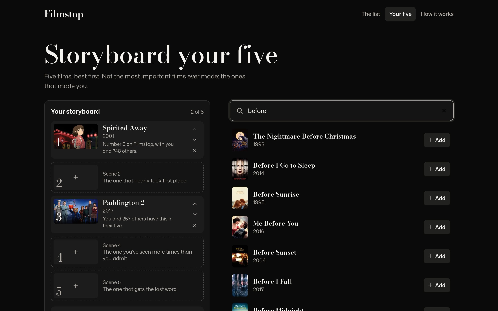
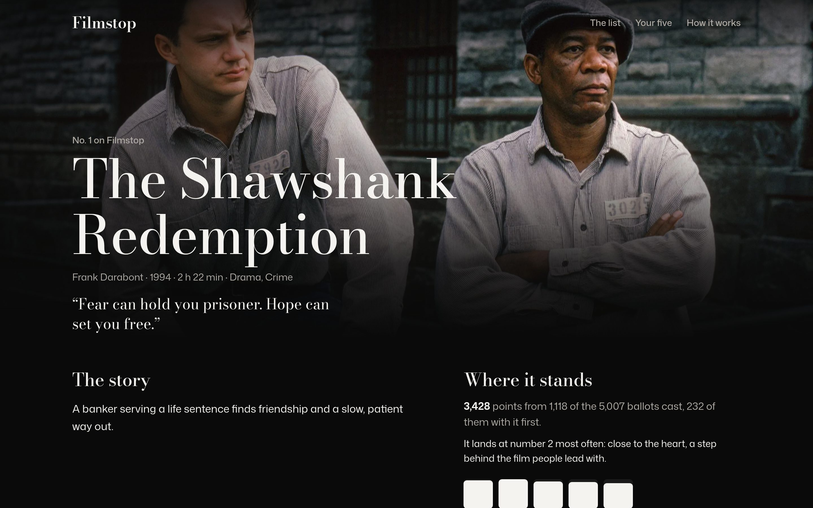
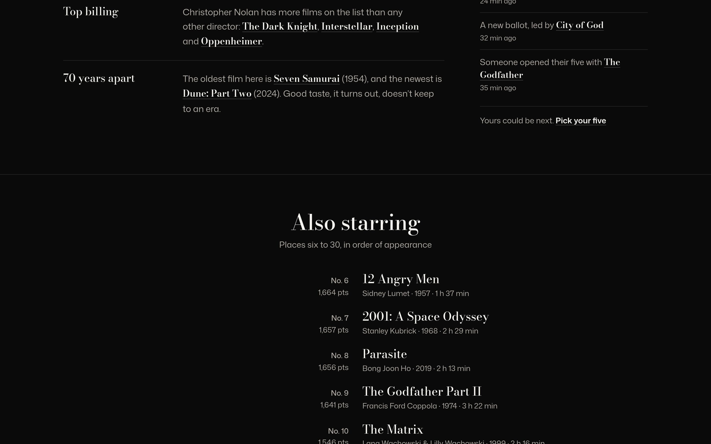
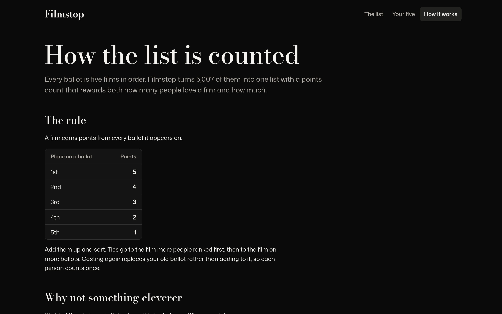

<div align="center">


# Filmstop

**Everyone names their five favourite films, in order. Filmstop counts every ballot into one list.**

The list plays like the opening of a film: the number one as a widescreen scene,<br />
two to five as scene selection, and the rest as end credits.

[](https://go.dev)
[](https://gin-gonic.com)
[](https://htmx.org)
[](https://turso.tech)
[](https://github.com/Binamra7/Filmstop/actions/workflows/ci.yml)

[Live site](https://filmstop.onrender.com) · [Screenshots](#screenshots) · [Features](#features) · [Getting started](#getting-started) · [How it works](#how-it-works) · [Docs](#docs)

<br />


</div>

## The idea

Most "best films" lists are one critic's opinion or an average of star ratings. Filmstop asks a narrower question: which five films made you, in order? Every ballot goes into one shared list, and position counts. A first place earns five points and a fifth place one, so a film that many people put first beats one that many people only mention.

The interface stays out of the frame. The page is black with no accent colour; all the colour comes from the films' own stills and posters. Film titles are set in Bodoni Moda, like title cards, and everything you read or press is in Mona Sans.

There are no accounts. A signed cookie gives each visitor one ballot, which they can change at any time.

## Screenshots

Captured on 17 October 2026 from the [live site](https://filmstop.onrender.com). The list holds about 5,000 ballots from the seed tool (made-up voters choosing from real films), so the counts are invented, but the pages are what visitors see.

<table>
  <tr>
    <td width="50%"></td>
    <td width="50%"></td>
  </tr>
  <tr>
    <td align="center"><sub>The list opens on the number one</sub></td>
    <td align="center"><sub>Your five: a storyboard and live search</sub></td>
  </tr>
  <tr>
    <td width="50%"></td>
    <td width="50%"></td>
  </tr>
  <tr>
    <td align="center"><sub>A film page</sub></td>
    <td align="center"><sub>A shareable five</sub></td>
  </tr>
</table>

<table>
  <tr>
    <td width="33%"></td>
    <td width="33%"></td>
    <td width="33%"></td>
  </tr>
</table>

<details>
<summary><b>More screenshots</b></summary>
<br />


<p align="center"><sub>End credits: places six to thirty</sub></p>


<p align="center"><sub>How it works: the scoring, explained on the site</sub></p>

</details>

## Features

**The list** (`/`)

- The number one opens full-bleed with its tagline, its points and a bar for each place it was ranked
- Two to five as a grid of scenes, six to thirty as rolling end credits
- Programme notes written from the votes: photo finishes, cult favourites, the most divisive film, a director with a clear lead
- The latest ballots as they come in, with no voter named

**Your five** (`/ballot`)

- A five-scene storyboard. Search TMDB, then add, reorder or remove films; the draft saves on every change
- Each pick shows how many others chose it and where it stands on the list
- Casting counts the ballot; casting again later replaces it

**Film pages and cards**

- `/film/:id`: the story, where the film stands, how voters place it, and the films that share its ballots
- `/five/:code`: a shareable page of someone's five with a reading of their taste: which decades, how close to the consensus, kindred ballots

**Small and fast**

- One Go binary with the templates, CSS, fonts and htmx embedded, and no JavaScript build step
- The list is rebuilt off the request path after each vote. The home page is rendered once per list version and served pre-gzipped
- Every action works without JavaScript; htmx swaps in fragments when it's available

## Getting started

You need Go 1.26 or newer. Film search needs a [TMDB API key](https://www.themoviedb.org/settings/api), either a v3 key or a v4 read token. Without one the site still runs, with search turned off.

```bash
git clone https://github.com/Binamra7/Filmstop.git
cd Filmstop
export TMDB_API_KEY=your_key_here
go run .                                   # http://localhost:8080
```

To fill the list with made-up ballots for development:

```bash
go run ./cmd/seed -db filmstop.db -voters 400
```

The seed needs no network. It casts ballots over a built-in catalogue of 72 real films and prints cookies for five personas (a voter with a card, a kindred ballot, an open draft, a newcomer and more), so you can browse as each one. With `TMDB_API_KEY` set it also fetches the films' real details, stills and posters. Running it again replaces the seeded ballots.

<details>
<summary><b>Configuration</b></summary>
<br />

| Variable | Default | What it does |
| --- | --- | --- |
| `PORT` | `8080` | Port to listen on |
| `DATABASE_PATH` | `filmstop.db` | SQLite file. Put it on a persistent disk |
| `TMDB_API_KEY` | none | Film search and details |
| `TURSO_DATABASE_URL` | none | Use this Turso database instead of the SQLite file |
| `TURSO_AUTH_TOKEN` | none | Token for `TURSO_DATABASE_URL` |

</details>

<details>
<summary><b>Docker</b></summary>
<br />

```bash
cp .env.example .env                       # add your TMDB_API_KEY
docker compose up -d --build               # http://localhost:8080
docker compose run --rm seed && docker compose restart web   # optional demo data
```

The database lives in the `filmstop-data` volume and survives rebuilds; `docker compose down -v` deletes it. The server reads the list at startup, so restart it after seeding. The image is a static binary on distroless and runs as a non-root user.

</details>

<details>
<summary><b>Deploying</b></summary>
<br />

The live site runs on Render's free web service, with the database on Turso's free plan. `render.yaml` describes the service, and Render asks for `TMDB_API_KEY`, `TURSO_DATABASE_URL` and `TURSO_AUTH_TOKEN` when you create it from the Blueprint. [`docs/DEPLOYMENT.md`](docs/DEPLOYMENT.md) has the full steps, including how to seed or reset the production list.

</details>

## How it works

The server is Gin with Go's `html/template`. Pages are plain HTML forms that htmx upgrades: adding, moving or removing a film posts to the server, which answers with the new storyboard fragment. Without JavaScript the same forms submit normally and redirect back.

| Route | Method | What it does |
| --- | --- | --- |
| `/` | GET | The list |
| `/ballot` | GET | Your storyboard and search |
| `/search?q=` | GET | Search results fragment (TMDB, cached for 30 minutes) |
| `/ballot/pick`, `/ballot/move`, `/ballot/remove` | POST | Edit the draft; returns the storyboard fragment |
| `/ballot/cast` | POST | Count the draft as your ballot |
| `/film/:id` | GET | A film's page |
| `/five`, `/five/:code` | GET | Your card, and a shared card by its code |
| `/method` | GET | How the list is counted |
| `/healthz` | GET | Health check |

**Counting.** Each ballot gives 5 points to its first film, down to 1 point for its fifth. Points are summed; ties go to the film with more first places, then more ballots. Plackett–Luce and Condorcet methods were tested and rejected. With top-five ballots drawn from every film ever made, they learn almost nothing from order; `internal/rank/pl_test.go` demonstrates it.

**Identity.** Each visitor gets a random id in an HMAC-signed, HttpOnly cookie. One cookie holds one ballot, and casting again replaces it. A POST whose `Origin` names another site is rejected.

**Storage.** SQLite through `database/sql`: the pure-Go `modernc.org/sqlite` driver for a local file, or Turso (hosted SQLite) over HTTP in production. Neither needs CGO.

```
main.go              server entry point: config, graceful shutdown, health-check flag
cmd/seed/            demo data: built-in film catalogue, taste groups, personas
internal/rank/       scoring and ordering (pure functions, tested)
internal/store/      ballots, drafts, films and share codes, in SQLite or Turso
internal/tmdb/       TMDB search with an in-memory cache, and per-film details
internal/web/        Gin handlers, the list keeper, programme notes, templates, static files
docs/                design, architecture, decisions, deployment, testing
```

## Docs

| Doc | What's in it |
| --- | --- |
| [`docs/ARCHITECTURE.md`](docs/ARCHITECTURE.md) | How a request flows, how the list is kept, the data model |
| [`docs/DECISIONS.md`](docs/DECISIONS.md) | Why Go and htmx, the scoring, SQLite and Turso, the hosting |
| [`docs/DEPLOYMENT.md`](docs/DEPLOYMENT.md) | Render and Turso setup, secrets, seeding and resetting production |
| [`docs/TESTING.md`](docs/TESTING.md) | Tests, benchmarks, CI and manual checks |
| [`docs/DESIGN.md`](docs/DESIGN.md) | The visual system: colour roles, type, layout, motion |
| [`AGENTS.md`](AGENTS.md) | Working notes for coding agents and people |

## Testing

```bash
go test -race ./...
```

The tests cover the scoring and its tie-breaks, the ballot flow end to end through the HTTP handlers, drafts and casting, share codes, programme notes, taste readings, film pages, and the retry for dropped Turso connections. CI also runs `gofmt`, `go vet`, `govulncheck` and a Docker build on every push and pull request. See [`docs/TESTING.md`](docs/TESTING.md).

## Acknowledgements

- Film data, stills and posters from [TMDB](https://www.themoviedb.org/). This product uses the TMDB API but is not endorsed or certified by TMDB.
- [Bodoni Moda](https://github.com/indestructible-type/Bodoni) by indestructible type\* and [Mona Sans](https://github.com/github/mona-sans) by GitHub, both under the SIL Open Font License (see `internal/web/static/OFL.txt`)
- [htmx](https://htmx.org), under the Zero-Clause BSD licence
- [Gin](https://gin-gonic.com), [modernc.org/sqlite](https://gitlab.com/cznic/sqlite) and [libsql-client-go](https://github.com/tursodatabase/libsql-client-go)
