<div align="center">


# Filmstop

**Everyone names their five favourite films, in order. Filmstop counts every ballot into one list.**

The list plays like a Saul Bass title sequence: each film in a field of colour taken from its poster,<br />
the number one as the opening scene, two to five as scene tiles, and the rest as end credits.

[](https://go.dev)
[](https://gin-gonic.com)
[](https://htmx.org)
[](https://turso.tech)
[](#how-it-works)
[](https://github.com/Binamra7/Filmstop/actions/workflows/ci.yml)

[Live site](https://filmstop.onrender.com) · [Screenshots](#screenshots) · [Features](#features) · [Getting started](#getting-started) · [How it works](#how-it-works) · [Design](#design) · [Docs](#docs)

<br />

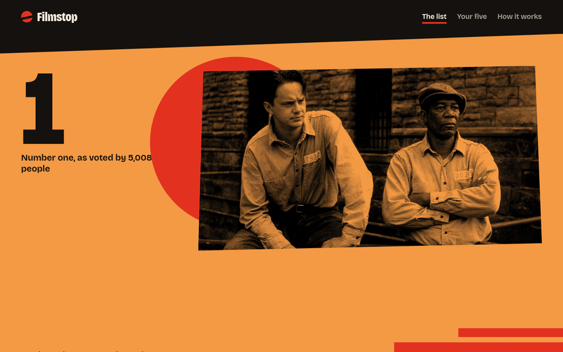

</div>

## The idea

Most "best films" lists are one critic's opinion or an average of star ratings. Filmstop asks a narrower question: which five films made you, in order? Every ballot goes into one shared list, and position counts. A first place earns five points and a fifth place one, so a film that many people put first beats one that many people only mention.

Each page plays like a Saul Bass title sequence cut from paper. Every film gets a flat field of colour taken from its own poster: the server measures the poster's dominant colour and maps it to one of eight fields, and each field's inks were solved to reach 8:1 contrast for primary text and 7:1 for secondary. Stills are printed in the field's colour and cropped by cut shapes, the title is pasted on a strip a few degrees off level, and casting your five plays a short title sequence that rolls your films as credits.

<p align="center">
  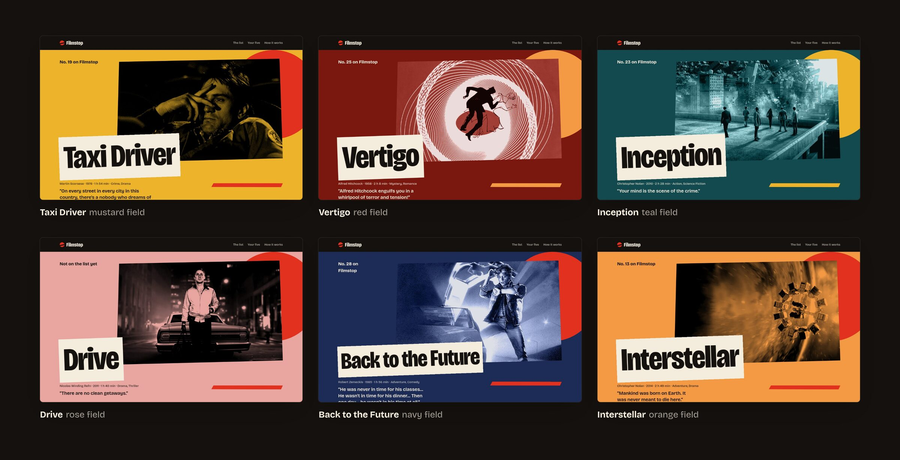
</p>

<p align="center">
  
  
  
  <br />
  
  
  
  
  
</p>

There are no accounts. A signed cookie gives each visitor one ballot, which they can change at any time.

## Screenshots

Captured on 17 October 2026 from the [live site](https://filmstop.onrender.com). The list holds seeded demo ballots from the seed tool (made-up voters choosing from real films), so the counts are invented, but the pages are what visitors see.

<table>
  <tr>
    <td width="50%">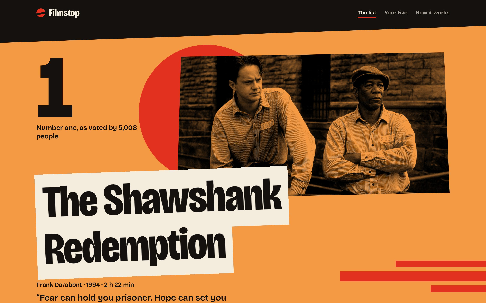</td>
    <td width="50%">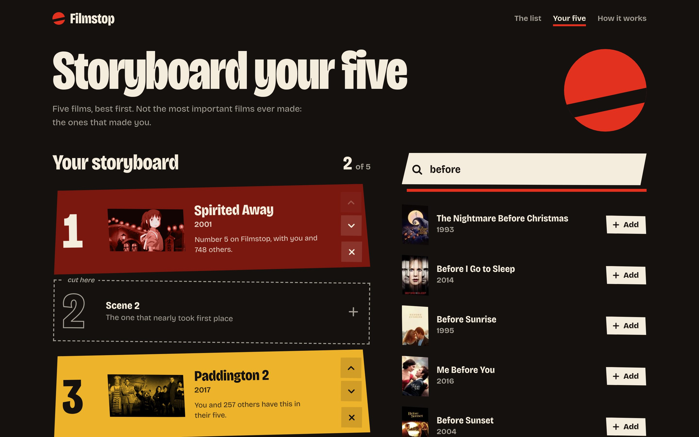</td>
  </tr>
  <tr>
    <td align="center"><sub>The list opens on the number one</sub></td>
    <td align="center"><sub>Your five: a storyboard and live search</sub></td>
  </tr>
  <tr>
    <td width="50%">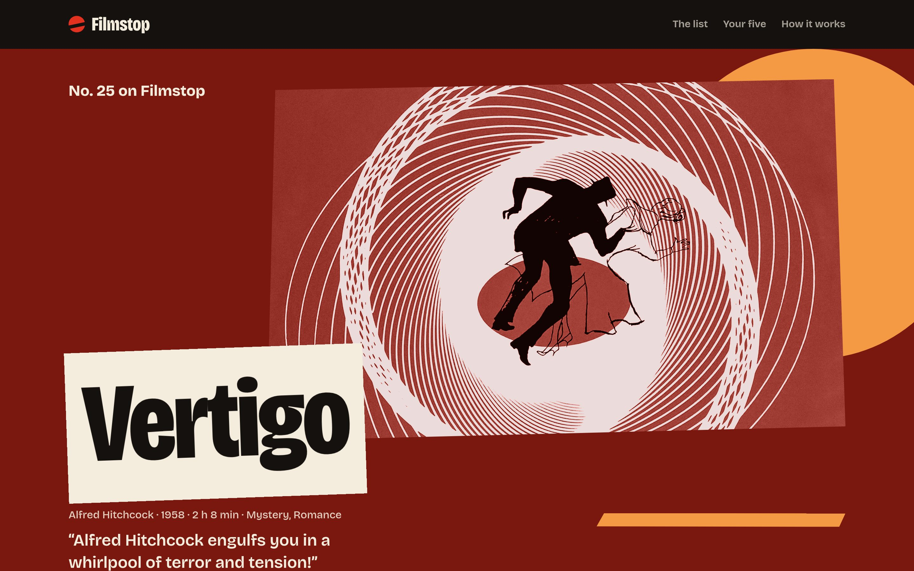</td>
    <td width="50%">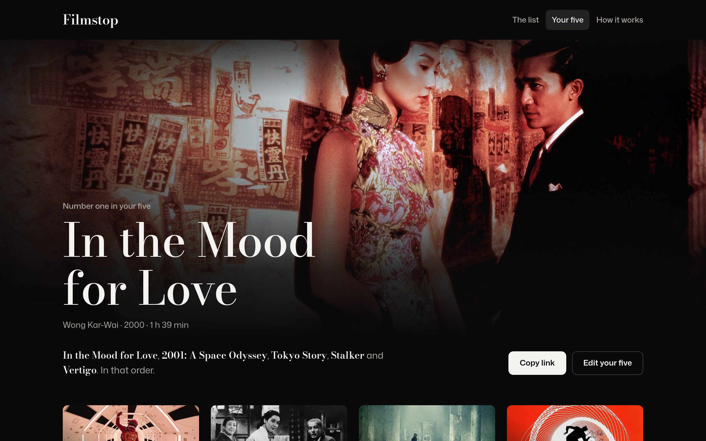</td>
  </tr>
  <tr>
    <td align="center"><sub>A film page: Vertigo</sub></td>
    <td align="center"><sub>A shareable five</sub></td>
  </tr>
</table>

<table>
  <tr>
    <td width="33%">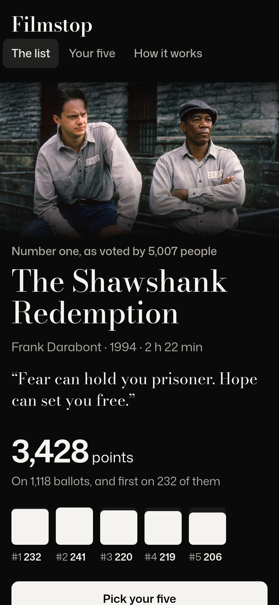</td>
    <td width="33%">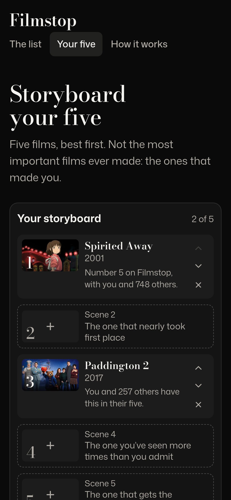</td>
    <td width="33%">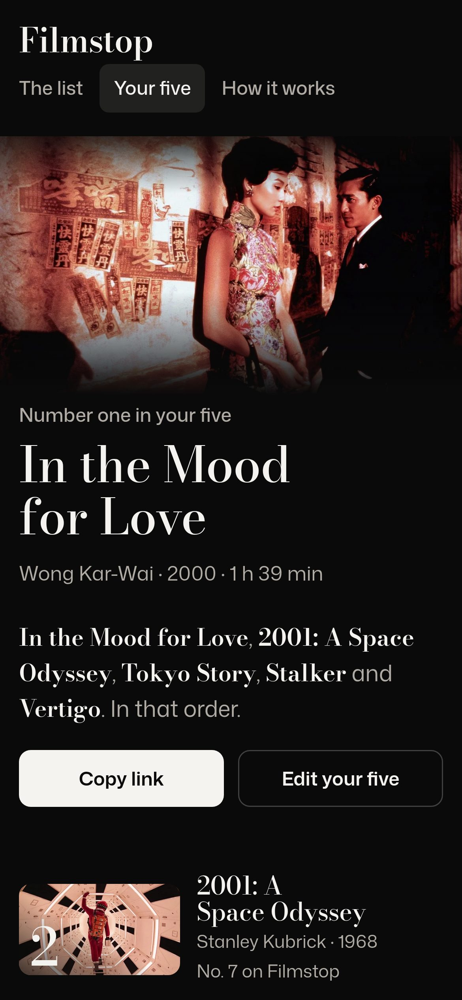</td>
  </tr>
</table>

<details>
<summary><b>More screenshots</b></summary>
<br />

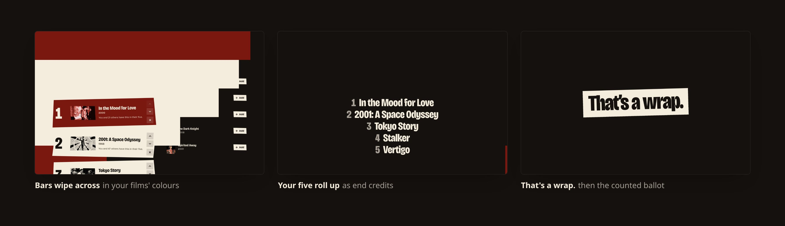
<p align="center"><sub>Casting plays a title sequence of your five (frames from a local build)</sub></p>

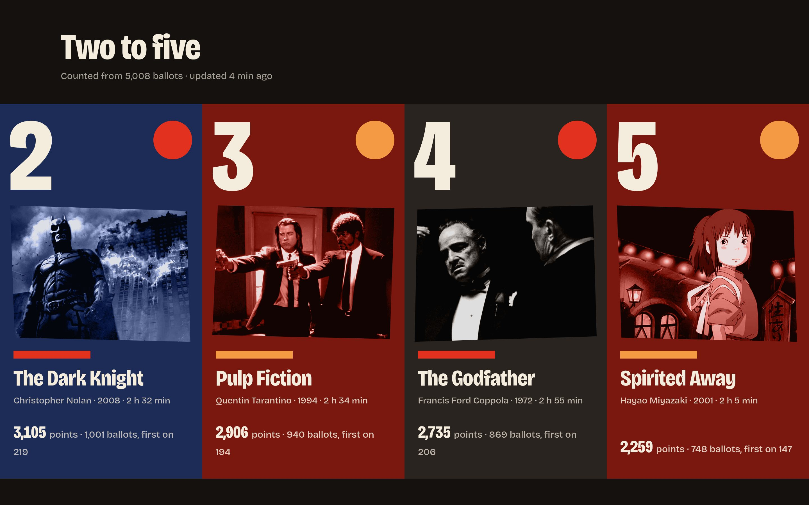
<p align="center"><sub>Two to five: scene tiles</sub></p>

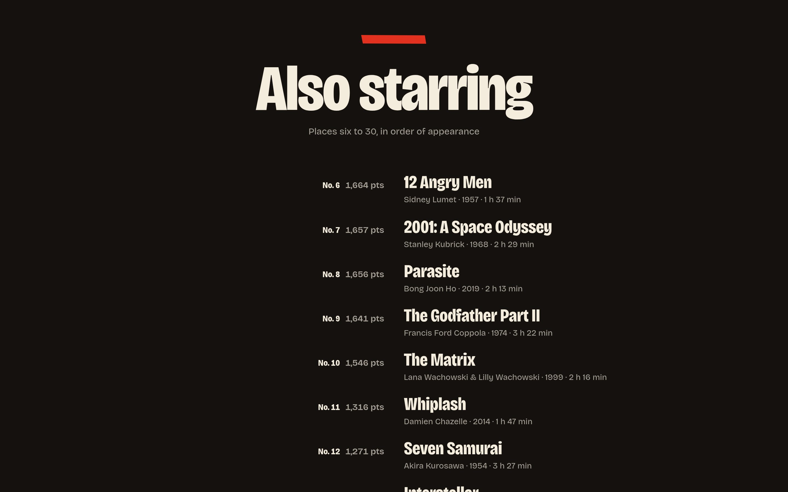
<p align="center"><sub>End credits: places six to thirty</sub></p>

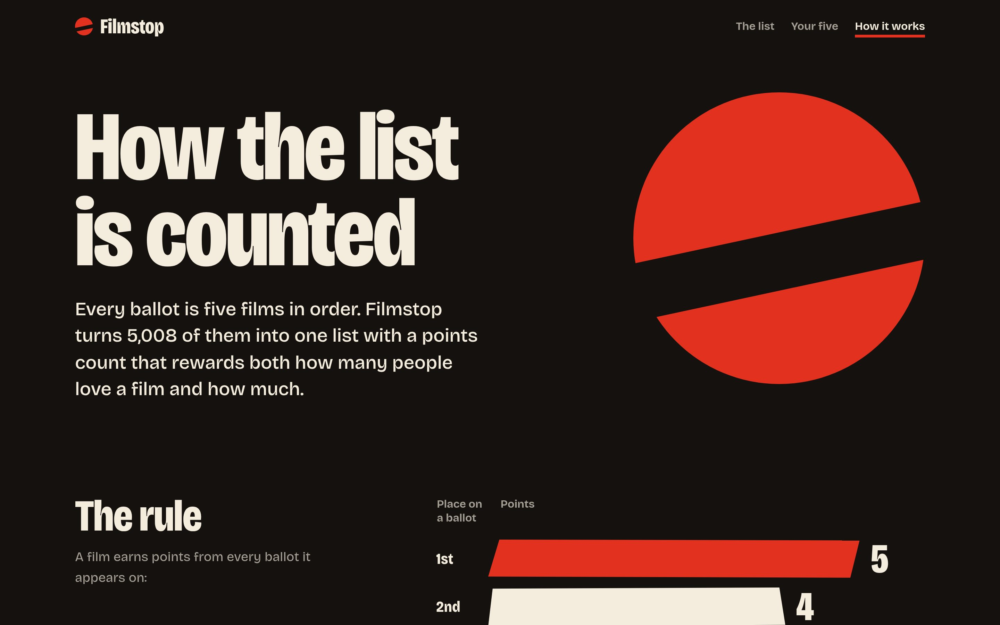
<p align="center"><sub>How it works: the scoring, explained on the site</sub></p>

</details>

## Features

**The list** (`/`)

- The number one opens full-bleed in its poster's colour field, with its tagline, its points and a bar for each place it was ranked
- Two to five as four scene tiles, each in its own field; six to thirty as rolling end credits on black
- Programme notes written from the votes: photo finishes, cult favourites, the most divisive film, a director with a clear lead
- The latest ballots as they come in, with no voter named

**Your five** (`/ballot`)

- Five numbered paper strips, each in its film's field. Search TMDB, then add, reorder or remove films; the draft saves on every change
- Each pick shows how many others chose it and where it stands on the list
- Casting counts the ballot; casting again later replaces it

**Film pages and cards**

- `/film/:id`: the story, where the film stands, how voters place it, and the films that share its ballots
- `/five/:code`: a shareable page of someone's five with a reading of their taste: which decades, how close to the consensus, kindred ballots

**Motion**

- The list, film pages and cards open with bars sweeping across the field, then the title strip drops into place
- A new pick slides into its slot, a removed one slides out, and moved strips animate to their new places (view transitions named per film, through htmx's `transition:true`)
- Casting plays a short title sequence: bars wipe across, your five titles roll as credits, then "That's a wrap." A click or any key skips it
- Printed stills regain their full colour on hover or keyboard focus
- With `prefers-reduced-motion` set, animations and transitions are turned off and the title sequence is not shown

**Small and fast**

- One Go binary with the templates, CSS, fonts and htmx embedded, and no JavaScript build step
- The list is rebuilt off the request path after each vote. The home page is rendered once per list version and served pre-gzipped
- Every action works without JavaScript; htmx swaps in fragments when it's available

## Getting started

You need Go 1.26 or newer. Film search needs a [TMDB API key](https://www.themoviedb.org/settings/api), either a v3 key or a v4 read token. Without one the site still runs, with search turned off.

```bash
git clone https://github.com/Binamra7/Filmstop.git
cd Filmstop
export TMDB_API_KEY=your_key_here
go run .                                   # http://localhost:8080
```

To fill the list with made-up ballots for development:

```bash
go run ./cmd/seed -db filmstop.db -voters 400
```

The seed needs no network. It casts ballots over a built-in catalogue of 72 real films and prints cookies for five personas (a voter with a card, a kindred ballot, an open draft, a newcomer and more), so you can browse as each one. With `TMDB_API_KEY` set it also fetches the films' real details, stills and posters. Running it again replaces the seeded ballots.

<details>
<summary><b>Configuration</b></summary>
<br />

| Variable | Default | What it does |
| --- | --- | --- |
| `PORT` | `8080` | Port to listen on |
| `DATABASE_PATH` | `filmstop.db` | SQLite file. Put it on a persistent disk |
| `TMDB_API_KEY` | none | Film search and details |
| `TURSO_DATABASE_URL` | none | Use this Turso database instead of the SQLite file |
| `TURSO_AUTH_TOKEN` | none | Token for `TURSO_DATABASE_URL` |

</details>

<details>
<summary><b>Docker</b></summary>
<br />

```bash
cp .env.example .env                       # add your TMDB_API_KEY
docker compose up -d --build               # http://localhost:8080
docker compose run --rm seed && docker compose restart web   # optional demo data
```

The database lives in the `filmstop-data` volume and survives rebuilds; `docker compose down -v` deletes it. The server reads the list at startup, so restart it after seeding. The image is a static binary on distroless and runs as a non-root user.

</details>

<details>
<summary><b>Deploying</b></summary>
<br />

The live site runs on Render's free web service, with the database on Turso's free plan. `render.yaml` describes the service, and Render asks for `TMDB_API_KEY`, `TURSO_DATABASE_URL` and `TURSO_AUTH_TOKEN` when you create it from the Blueprint. [`docs/DEPLOYMENT.md`](docs/DEPLOYMENT.md) has the full steps, including how to seed or reset the production list.

</details>

## How it works

The server is Gin with Go's `html/template`. Pages are plain HTML forms that htmx upgrades: adding, moving or removing a film posts to the server, which answers with the new storyboard fragment. Without JavaScript the same forms submit normally and redirect back.

| Route | Method | What it does |
| --- | --- | --- |
| `/` | GET | The list |
| `/ballot` | GET | Your storyboard and search |
| `/search?q=` | GET | Search results fragment (TMDB, cached for 30 minutes) |
| `/ballot/pick`, `/ballot/move`, `/ballot/remove` | POST | Edit the draft; returns the storyboard fragment |
| `/ballot/cast` | POST | Count the draft as your ballot |
| `/film/:id` | GET | A film's page |
| `/five`, `/five/:code` | GET | Your card, and a shared card by its code |
| `/method` | GET | How the list is counted |
| `/healthz` | GET | Health check |

**Counting.** Each ballot gives 5 points to its first film, down to 1 point for its fifth. Points are summed; ties go to the film with more first places, then more ballots. Plackett–Luce and Condorcet methods were tested and rejected. With top-five ballots drawn from every film ever made, they learn almost nothing from order; `internal/rank/pl_test.go` demonstrates it.

**Identity.** Each visitor gets a random id in an HMAC-signed, HttpOnly cookie. One cookie holds one ballot, and casting again replaces it. A POST whose `Origin` names another site is rejected.

**Colour fields.** When the server fetches a film's details from TMDB, it also downloads the poster at TMDB's smallest size (`w92`, 92 px wide) and measures its dominant colour (`internal/tmdb/swatch.go`): each vivid pixel votes for one of 36 hue bins, weighted by saturation times value, and the winning bin's average colour is stored in the film's `swatch` column. At render time `fieldOf` in `internal/web/field.go` maps that colour's hue to one of the eight fields, with grey and very dark posters going to `ink`. A film not measured yet gets a field from its id, so its colour stays stable.

**Storage.** SQLite through `database/sql`: the pure-Go `modernc.org/sqlite` driver for a local file, or Turso (hosted SQLite) over HTTP in production. Neither needs CGO.

```
main.go              server entry point: config, graceful shutdown, health-check flag
cmd/seed/            demo data: built-in film catalogue, taste groups, personas
internal/rank/       scoring and ordering (pure functions, tested)
internal/store/      ballots, drafts, films and share codes, in SQLite or Turso
internal/tmdb/       TMDB search with an in-memory cache, per-film details, poster colour
internal/web/        Gin handlers, the list keeper, programme notes, colour fields, templates, static files
docs/                design, architecture, decisions, deployment, testing
```

## Design

The full system lives in [`docs/DESIGN.md`](docs/DESIGN.md), and the tokens are in [`internal/web/static/site.css`](internal/web/static/site.css). In short:

- **Fields from posters:** each film takes one of eight colour fields from its poster's dominant colour. Every field defines its own ink, secondary ink and shape colour, checked to 8:1 and 7:1 contrast. Vermilion can't carry text at that contrast, so it is used only for shapes.
- **Type:** one variable family, [Bricolage Grotesque](https://github.com/ateliertriay/bricolage), self-hosted, using its weight, width and optical size axes: heavy and narrow for titles and numbers, regular width for body text. Nothing is smaller than 14 px.
- **Shapes:** stills and panels have cut edges from three reused polygons, stills are printed greyscale onto the field colour, and the decoration is limited to bars, discs and jagged strips. Sections are separated by changes of field, not boxes.
- **Motion:** one authored moment per page (the opening sweep, a pick sliding in, the cast title sequence), then stillness.

## Docs

| Doc | What's in it |
| --- | --- |
| [`docs/ARCHITECTURE.md`](docs/ARCHITECTURE.md) | How a request flows, how the list is kept, the data model |
| [`docs/DECISIONS.md`](docs/DECISIONS.md) | Why Go and htmx, the scoring, SQLite and Turso, the hosting |
| [`docs/DEPLOYMENT.md`](docs/DEPLOYMENT.md) | Render and Turso setup, secrets, seeding and resetting production |
| [`docs/TESTING.md`](docs/TESTING.md) | Tests, benchmarks, CI and manual checks |
| [`docs/DESIGN.md`](docs/DESIGN.md) | The visual system: colour fields, type, shapes, layout, motion |
| [`AGENTS.md`](AGENTS.md) | Working notes for coding agents and people |

## Testing

```bash
go test -race ./...
```

The tests cover the scoring and its tie-breaks, the ballot flow end to end through the HTTP handlers, drafts and casting, share codes, programme notes, taste readings, film pages, and the retry for dropped Turso connections. CI also runs `gofmt`, `go vet`, `govulncheck` and a Docker build on every push and pull request. See [`docs/TESTING.md`](docs/TESTING.md).

## Acknowledgements

- Film data, stills and posters from [TMDB](https://www.themoviedb.org/). This product uses the TMDB API but is not endorsed or certified by TMDB.
- [Bricolage Grotesque](https://github.com/ateliertriay/bricolage) by Mathieu Triay, under the SIL Open Font License (see `internal/web/static/OFL.txt`)
- [htmx](https://htmx.org), under the Zero-Clause BSD licence
- [Gin](https://gin-gonic.com), [modernc.org/sqlite](https://gitlab.com/cznic/sqlite) and [libsql-client-go](https://github.com/tursodatabase/libsql-client-go)
- Visual approach after Saul Bass's title sequences and posters (*Vertigo*, *Anatomy of a Murder*, *The Man with the Golden Arm*)
